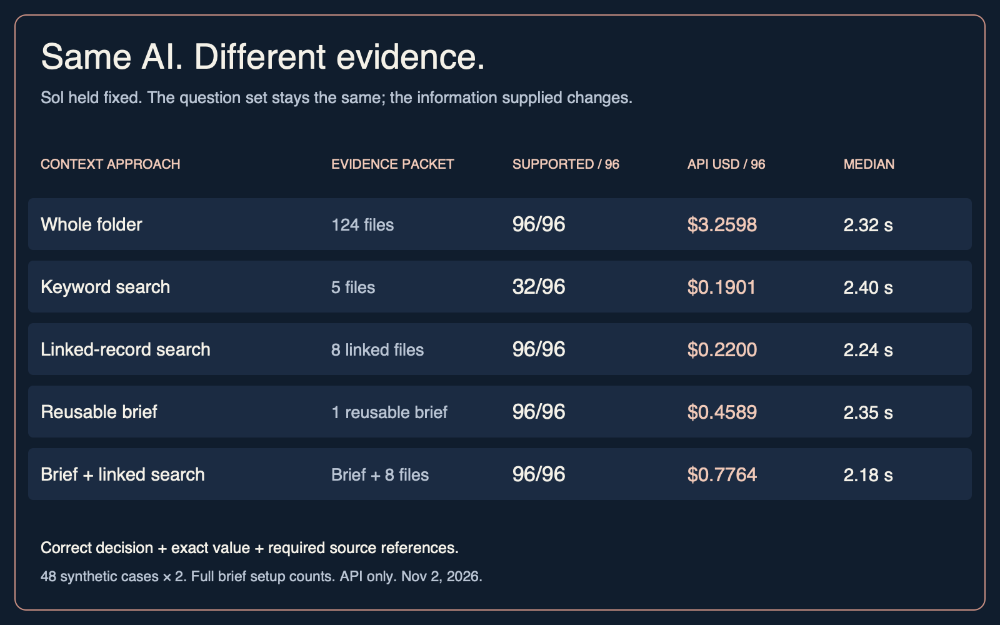

# E008: more context versus better context

Experiment and writeup date: 2026-11-02. Models: GPT-6 Luna and GPT-6.1 Sol.

## Question and intended users

Can selecting evidence produce reliable, less costly administrative answers than supplying an entire folder? Intended users are knowledge workers, business operators and AI product engineers. Tested settings: synthetic refunds, bookings and invoice approvals. No external operational action occurred.

## Main results

| Model / approach | Supported / 96 | Decision correct / 96 | USD / supported | Median seconds |
|---|---:|---:|---:|---:|
| Luna / Whole folder | 94 | 94 | $0.00175 | 2.27 |
| Luna / Keyword search | 28 | 52 | $0.00051 | 2.95 |
| Luna / Linked-record search | 96 | 96 | $0.00014 | 2.23 |
| Luna / Reusable brief | 93 | 93 | $0.00181 | 2.13 |
| Luna / Brief + linked search | 95 | 96 | $0.00193 | 2.03 |
| Sol / Whole folder | 96 | 96 | $0.03396 | 2.32 |
| Sol / Keyword search | 32 | 55 | $0.00594 | 2.40 |
| Sol / Linked-record search | 96 | 96 | $0.00229 | 2.24 |
| Sol / Reusable brief | 96 | 96 | $0.00478 | 2.35 |
| Sol / Brief + linked search | 96 | 96 | $0.00809 | 2.18 |

Supported-correct means exact decision and numeric value plus the three explicitly required source IDs, with no cited ID absent from supplied material. The adjacent decision-only column prevents source-format failures being mistaken for all decision failures. Costs above include full standalone preparation for brief strategies.

## Method and reproducible versions

Three original synthetic folders, 124 documents each: current policy, three archived policies, 40 paired account/job/invoice records and 80 unrelated notes. Each folder has four development and 16 held-out cases, spanning ten rule patterns. 48 held-out cases reuse 30 domain/rule-pattern groups. Two attempts each per model/strategy give 96 outcomes per condition and 960 primary outputs. Repeats are not independent new cases.

Five frozen strategies: whole folder; BM25 top five; explicit ID-linked records plus CURRENT policy, filled to eight via BM25; one question-blind Sol briefing per folder; and briefing plus linked search. BM25 uses k1=1.5, b=0.75 over complete short documents, deterministic tokenization and document-ID tie breaking. Linked search relies on public structured titles/IDs and current-policy labels, not gold evidence IDs. It is not a general semantic retriever. The author designed the fixtures, so this is not independently administered.

The development-only source audit exposed poor lexical recall before paid evaluation. Top 3/5/8/12/16/24 gave full evidence in 4/12 development cases; top 32 covered 12/12. We retained top five as a simple baseline and added the linked alternative before held-out dispatch. No held-out answer tuned the selector. Better lexical tuning, embeddings or reranking could change results.

Brief preparation saw folders only, before any test question. It requested all operational facts/exceptions with original source IDs and no computed answers. Sol low reasoning, output cap 8192, one preparation per domain; those fixed texts were shared by both solvers. This is AI-generated curation, not a measured human-curation baseline.

Both solvers used low reasoning, output cap 2048 including reasoning, standard Responses service tier, implicit 30-minute cache, no tools and provider-default sampling. Requested aliases: gpt-6-luna and gpt-6.1-sol. Exact resolved IDs are retained per request. Common effort labels do not establish equal compute between models. All within-model context comparisons use the same answer instructions and JSON schema.

Order is seeded/interleaved across three concurrent calls. Whole-folder order changes between the two repeats and is shared across strategies for each repeat. Thus repeat differences combine stochastic variation and document-order variation; the study does not isolate those causes. Corpus size is roughly 66 KB/domain, not near advertised million-token windows.

## Scoring and source coverage

Public output schema: decision approve/decline/clarify; integer-or-null value; evidence list; short reason. Refund/invoice values are cents; booking values are minutes after midnight. Decline is 0; clarification is null. Golden labels and required-evidence lists never enter solver prompts or search. Booking labels were checked against exhaustive minute enumeration; refund/invoice known boundaries and arithmetic were checked offline.

A paid smoke preceded development. All 120 development outputs had valid schemas and no provider errors. Two Luna booking mistakes were manually traced to crossing a break despite correct evidence. No prompt/selector changes followed. Development-audit.json was recorded before the first held-out dispatch.

No model judge is used. Free-text reason truthfulness is not comprehensively scored; examples are inspected separately. Source-ID presence is not citation entailment. Briefs may mention a source without preserving every fact, so reference availability must not be read as complete factual recall.

| Model / approach | Source IDs available / 96 | Incorrect approvals | Missed clarifications | Correct decision, bad refs |
|---|---:|---:|---:|---:|
| luna / Whole folder | 96 | 2 | 0 | 0 |
| luna / Keyword search | 32 | 5 | 0 | 24 |
| luna / Linked-record search | 96 | 0 | 0 | 0 |
| luna / Reusable brief | 96 | 3 | 0 | 0 |
| luna / Brief + linked search | 96 | 0 | 0 | 1 |
| sol / Whole folder | 96 | 0 | 0 | 0 |
| sol / Keyword search | 32 | 0 | 0 | 23 |
| sol / Linked-record search | 96 | 0 | 0 | 0 |
| sol / Reusable brief | 96 | 0 | 0 | 0 |
| sol / Brief + linked search | 96 | 0 | 0 | 0 |

Across the 960 primary outputs: 0 invalid schemas and 1 outputs citing a source absent from their supplied material. Incorrect approvals include approval with the wrong numeric value.

## Cost accounting and preparation scenarios

| Model / approach | Answer API USD | Full setup USD | Standalone total USD | Uncached-answer estimate USD |
|---|---:|---:|---:|---:|
| luna / Whole folder | 0.164853 | 0.000000 | 0.164853 | 0.132887 |
| luna / Keyword search | 0.014206 | 0.000000 | 0.014206 | 0.014163 |
| luna / Linked-record search | 0.013462 | 0.000000 | 0.013462 | 0.013411 |
| luna / Reusable brief | 0.017634 | 0.150244 | 0.167878 | 0.023539 |
| luna / Brief + linked search | 0.032992 | 0.150244 | 0.183236 | 0.028920 |
| sol / Whole folder | 3.259802 | 0.000000 | 3.259802 | 2.621434 |
| sol / Keyword search | 0.190098 | 0.000000 | 0.190098 | 0.190098 |
| sol / Linked-record search | 0.220004 | 0.000000 | 0.220004 | 0.220004 |
| sol / Reusable brief | 0.308686 | 0.150244 | 0.458930 | 0.437206 |
| sol / Brief + linked search | 0.626107 | 0.150244 | 0.776351 | 0.547370 |

Three actual preparation calls cost $0.150244. Full experiment: $5.852750 reconciled, $0.000000 reserved, 1131 requests, cap $50. Preparation, development, primary trials and size diagnostics all count. Scenario rows charge the full preparation once to each hypothetical standalone briefing deployment, shared across its 96 calls. They must not be summed as actual experiment charges. The protocol's half-shared allocation remains in results.json; a prospective development-stage clarification added the conservative full-setup scenario before held-out results.

Observed provider cache reads and writes count as billed. The uncached-answer column is a hypothetical estimate using actual input/output units at uncached input rates; it is not an additional charge, rerun or latency measurement. Full API spend excludes unobservable Codex-session charges, unrelated provider usage, engineering, hardware and electricity. Provider invoices may differ; the local ledger rounds each request upward to a microdollar.

Every dispatch fetched official current pricing, reserved a conservative upper bound atomically in the existing Mac mini SQLite authority, then reconciled actual usage. The E008 profile limits text to 80000 UTF-8 bytes and reserves 3×bytes+2048 input tokens, below 272000; output limits include reasoning. Missing usage retains reservations; no automatic retries. Historical E001/C002 unknown reservations are untouched. Rates, checked/effective dates, cache units and requested/resolved IDs are saved per call.

## Speed and uncertainty

Main table times are median request-plus-local-selection seconds. API timing includes network, provider queueing and reasoning, not just token generation. Three concurrent interleaved requests and caching mean these are observed workflow times, not isolated throughput benchmarks. p95 values and exact usage are in results.json. Brief preparation latency is additional one-time setup, excluded from per-question timing.

95% paired percentile-bootstrap intervals for supported-success differences versus whole folder: 4000 resamples, clustering by 30 domain/rule patterns and retaining all related cases and repeats. Exploratory multiple comparisons, not a proof of equivalence or universal quality ranking. Zero-width intervals occur when all observed paired scores are identical; this bootstrap cannot quantify failures absent from the sample.

- Luna, Keyword search: -84.6 to -53.0 percentage points versus whole-folder.
- Luna, Linked-record search: +0.0 to +5.3 percentage points versus whole-folder.
- Luna, Reusable brief: -6.8 to +4.0 percentage points versus whole-folder.
- Luna, Brief + linked search: -2.1 to +4.8 percentage points versus whole-folder.
- Sol, Keyword search: -83.7 to -48.1 percentage points versus whole-folder.
- Sol, Linked-record search: +0.0 to +0.0 percentage points versus whole-folder.
- Sol, Reusable brief: +0.0 to +0.0 percentage points versus whole-folder.
- Sol, Brief + linked search: +0.0 to +0.0 percentage points versus whole-folder.

## Preselected smaller-folder diagnostic

First four held-out cases per domain, two models/two repeats: 48 additional outputs. Removed only 80 unrelated notes, retaining all 44 operational/policy documents and unchanged questions. This is a bounded size diagnostic, not a broad positional or extreme-context study.

- Luna: full folder 24/24, unrelated notes removed 24/24; API $0.041163 versus $0.010541; median 2.26s versus 1.86s.
- Sol: full folder 24/24, unrelated notes removed 24/24; API $0.814196 versus $0.202426; median 2.22s versus 2.18s.

## Observed failures

- B-816, luna, brief, repeat 1: returned approve, value 1020; expected decline, value 0. Saved explanation: "The technician has the required skill and valid credential. After travel, the earliest feasible start is 1020, and the 40-minute job fits the customer window, shift, and break schedule."
- B-918, luna, whole, repeat 1: returned approve, value 600; expected decline, value 0. Saved explanation: "The technician has the required skill and valid credential; earliest arrival is 595, and the 50-minute job fits the first customer window starting at 600 without overlapping the break or shift limits."
- B-952, luna, brief, repeat 1: returned approve, value 690; expected approve, value 750. Saved explanation: "The technician has the required skill and valid credential; the 60-minute job fits the customer window and shift, ending exactly when the break starts."

All original outputs and failure records are preserved. No held-out error triggered a repair, changed a selector or was silently excluded. Missing evidence in top-five search, arithmetic/time reasoning, briefing omissions and reference completeness are different possible failure modes; no causal claim is inferred solely from a score difference.

## Practical solution and production gap

The standard-library context engine builds an evidence packet using explicit record relationships and current-policy labels. The offline explorer replays saved first attempts, their sources and actual request cost. CLI: python3 scripts/context_demo.py --case R-867 --strategy linked. It can export the exact prompt without making an API call. Public export: https://github.com/MaciekCi/mc-lab-context-selection.

Production still requires access control, up-to-date sources, real-format extraction, permission-aware retrieval, injection defenses, citation/answer validation, monitoring, useful abstention and human review before consequential actions. No live CRM, calendar, payment or email integration is implied.

The fixtures deliberately expose structured fields inside documents. Their deterministic reference functions provide answer keys, not a separately evaluated production system. A rules engine may be sufficient once those inputs are reliably extracted; this study does not establish that an LLM is necessary for the business calculation or approval itself.

## Provenance and reproduction

Run 20261102-e008-v1. Runtime/source/fixture hashes and seed 20261102 are in immutable manifest.json. Exact prompts, redacted model text, UTC dates, token/cache units, timing and pricing are retained; 1131 dispatch-payload hashes matched reconstruction. Aggregates are privately versioned; raw paid artifacts remain ignored and require checksum-verified copies on both Macs. Backup status is in publication metadata; no recurring backup is assumed.

[Luna pricing](https://developers.openai.com/api/docs/models/gpt-6-luna), [Sol pricing](https://developers.openai.com/api/docs/models/gpt-6.1-sol), [context evaluation guidance](https://developers.openai.com/api/docs/guides/optimizing-llm-accuracy), [historical Lost in the Middle research](https://arxiv.org/abs/2307.03172). The historical paper motivates testing; it is not evidence that the same effect explains this run.

These results apply to these synthetic cases, models and settings. LLM outputs vary between runs, and another workload could tell a different story.
